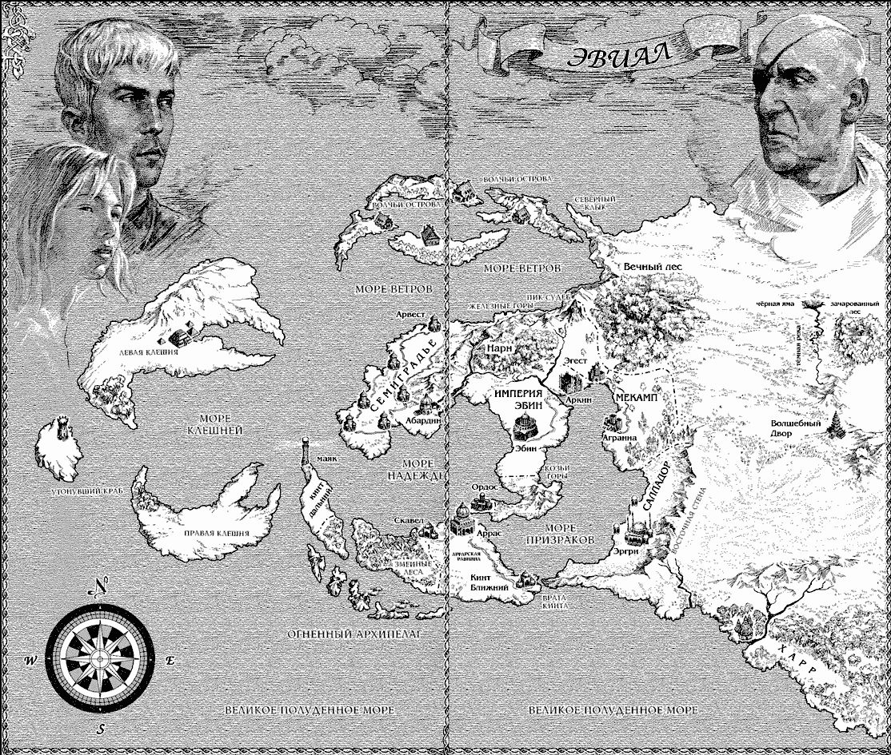

# География мира Эвиал

Мир называется **Эвиал**. [Карта мира](../maps/evial.jpg) взята из цикла Ника Перумова про Эвиал («Война мага»), но мир здесь свой: народы и история отличаются от книжных.

**Масштаб.** Карта очень крупная: между соседними городами неделя пути, прямой переход через мёртвую пустыню занимает около полутора месяцев.

## Запад: моря и острова

- **[Утонувший Краб](../places/sunken-crab.md).** Затонувший материк техномагической цивилизации. От него остались Левая Клешня, Правая Клешня и Море Клешней. Живут гномы и тифлинги.
- **[Огненный архипелаг](../places/fire-archipelago.md).** На юге, у Змеиных лесов. Красные драконы и драконорождённые.
- **Кинт Дальний** с маяком: длинный остров между Морем Клешней и Морем Надежды.
- **Змеиные леса** и город **Скавел**: юго-западный полуостров у Огненного архипелага.

## Север

- **[Волчьи острова](../places/wolf-islands.md)** за **Морем Ветров**: ледяные великаны, голиафы «и прочие». Там же мыс **Северный Клык**.
- **[Железные горы](../places/iron-mountains.md)** вдоль северного берега, от Арвеста к **Пику Судеб**. Здесь живут дварфы.
- **[Вечный лес](../places/eternal-forest.md)**: эльфы.

## Центр

- **[Семиградье](../places/semigradye.md).** Запад материка. Подписаны города **Арвест** и **Абардин**.
- **[Нарн](../places/narn.md).** Между Семиградьем и Эгестом, земли тёмных эльфов. Геннадиус, скорее всего, с юга Семиградья.
- **[Эгест](../places/egest.md).** Между Вечным лесом и империей, рядом город **Аркин**. Здесь начинается кампания.
- **[Империя Эбин](../places/empire-ebin.md).** Центр материка, столица Эбин. Родина Каина. На юге лежат **Козьи горы**, **Ордос**, **Аррас** и **Аррасская равнина**, ещё южнее **Кинт Ближний** и **Врата Кинта**.
- **[Мекамп](../places/mekamp.md).** К востоку от Эгеста, здесь город **Агранна**. Сюда ходят в набеги орки.
- Внутренние моря: **Море Надежды** между Семиградьем и империей и **Море Призраков** к югу от империи.

## Восток

- **[Саппадор](../places/sappador.md)** и **Восточная стена.** Узкая полоса вдоль стены, город **Эргри**. Здесь аасимары, которые «охраняют» мир от пустыни и воюют с орками.
- **Мёртвая пустыня** за Восточной стеной. Ни людей, ни зверей, ни растений.
- **[Волшебный двор](../places/wizard-court.md).** Город-башня магов.
- **[Чёрная яма](../places/black-pit.md)** и **[Зачарованный лес](../places/enchanted-forest.md)** к северу от Волшебного двора. От ямы на юг течёт **[Чёрная река](../places/black-river.md)**.
- **[Земли полуросликов](../places/halfling-lands.md).** Над пустыней, между Мекампом и Зачарованным лесом. Холодная пустыня, на карте не подписаны.
- **[Харр](../places/harr.md).** Юго-восток, земли орков, родина Бабалая.
- Дальше на восток, по рассказам, тянется саванна, за ней поднимаются всё более высокие горы, а что за ними, никто не знает.

## Юг

- **Великое Полуденное море.**

## Кто где живёт (сводка)

| Народ | Где |
|---|---|
| Эльфы | Вечный лес; родина где-то на севере |
| Тёмные эльфы | [Нарн](../places/narn.md) |
| Гномы, тифлинги | Утонувший Краб |
| Драконорождённые, красные драконы | Огненный архипелаг |
| Голиафы, ледяные великаны | Волчьи острова |
| Дварфы | Железные горы, горы северных островов |
| Аасимары | Саппадор |
| Орки | Харр |
| Полурослики | [между Мекампом и Зачарованным лесом](../places/halfling-lands.md), над пустыней |
| Люди | все остальные земли: Семиградье, Эбин, Эгест, Мекамп и т. д. |
