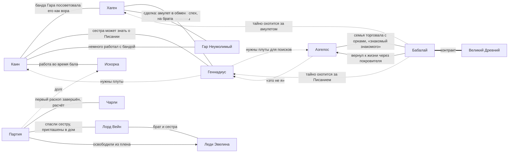

# Связи между персонажами

| Кто | С кем | Связь | Знает ли второй |
|---|---|---|---|
| Хаген | Геннадиус | доспех Геннадиуса выковала семья Хагена, давно знакомы | да |
| Хаген | Каин | банда Гара посоветовала Каина как опытного вора, чтобы выкрасть амулет | да |
| Каин | Геннадиус | сестра Каина может знать о Писании; Геннадиусу нужны плуты | да |
| Азгелос | Бабалай | семья Азгелоса торговала с орками в их походах; знакомые посоветовали держаться Бабалая | да |
| Бабалай | Хаген, Геннадиус | хочет забрать амулет и Писание для покровителя | **нет, тайна** |
| Все | Все | знакомы уже какое-то время и успели вместе что-то пережить | да |
| Каин | [Искорка](characters/npc/iskorka.md) и её босс | согласился поработать во время бала в обмен на помощь с его «проблемой» | Азгелос слышал разговор, остальные знают только, что какое-то задание есть |
| Партия | [Искорка](characters/npc/iskorka.md), [«Огненная дорога»](factions/fire-road.md) | за переполох в лагере за партией долг | да |
| Партия | [Чарли](characters/npc/charlie.md) | первоначально охрана за серебряный в день; первый раскоп завершён, расчёт состоялся, в Баракине расстались | да; точные суммы требуют сверки |
| Азгелос | Геннадиус | хочет украсть принцессу, символ веры Геннадиуса; клянётся, что ночной переполох у замка устроил не он | Геннадиус сомневается |
| Каин | партия | о сестре партии не рассказывал | нет |
| Бабалай | покровитель | подношение света статуэтки; личное видение пяти силуэтов и крылатого образа | видение пережил только Бабалай; Геннадиус видел его беспамятство и последующий холодный эффект |
| Бабалай | Азгелос | глубже принял метку ради воскрешения; спасённый благодарен и считает себя должным | да; остальные присутствовали при сделке и воскрешении, полурослику рассказали после пробуждения |
| Азгелос | партия | рассказал сон о зовущем голосе; Бабалай попросил сообщать о возможных требованиях | да; источник голоса и связь с воскрешением не подтверждены |
| Партия | Чарли | скрыли Сердце и роль покровителя в воскрешении; внешние изменения объяснили ядовитой ловушкой; изумруды тоже не показывали | **нет, скрыто от Чарли**; чашу и карту он видел |
| Геннадиус | Азгелос | нёс тело через храм, принёс к месту воскрешения и затем лечил | спасённому сообщили, что его вернули через Бабалая; объём рассказа о переноске тела не установлен |
| Каин | партия | принёс связанного пленника в жертву для открытия завесы; Геннадиус согласился отойти и отвернуться | спутники знали о действии; это не раскрывает тайные цели Бабалая |
| Партия | Вейн, Эвелина | наняты найти сестру; спасли и вернули, получили приглашение в дом Вейнов | да; о судьбе охраны и выкупе Эвелина рассказала после освобождения |

Общий принцип мастера: уход из партии после выполнения своей цели должен быть трудным выбором, а не само собой разумеющимся.
