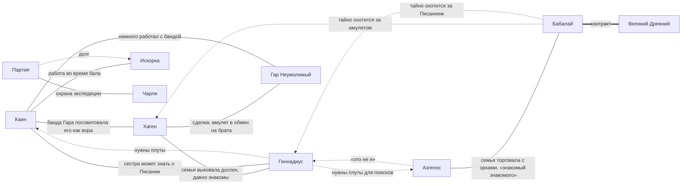

# Связи между персонажами

| Кто | С кем | Связь | Знает ли второй |
|---|---|---|---|
| Хаген | Геннадиус | доспех Геннадиуса выковала семья Хагена, давно знакомы | да |
| Хаген | Каин | банда Гара посоветовала Каина как опытного вора, чтобы выкрасть амулет | да |
| Каин | Геннадиус | сестра Каина может знать о Писании; Геннадиусу нужны плуты | да |
| Азгелос | Бабалай | семья Азгелоса торговала с орками в их походах; знакомые посоветовали держаться Бабалая | да |
| Бабалай | Хаген, Геннадиус | хочет забрать амулет и Писание для покровителя | **нет, тайна** |
| Все | Все | знакомы уже какое-то время и успели вместе что-то пережить | да |
| Каин | [Искорка](characters/npc/iskorka.md) и её босс | согласился поработать во время бала в обмен на помощь с его «проблемой» | Азгелос слышал разговор, остальные знают только, что какое-то задание есть |
| Партия | [Искорка](characters/npc/iskorka.md), [«Огненная дорога»](factions/fire-road.md) | за переполох в лагере за партией долг | да |
| Партия | [Чарли](characters/npc/charlie.md) | охраняют его экспедицию за серебряный в день | да |
| Азгелос | Геннадиус | хочет украсть принцессу, символ веры Геннадиуса; клянётся, что ночной переполох у замка устроил не он | Геннадиус сомневается |
| Каин | партия | о сестре партии не рассказывал | нет |

Общий принцип мастера: уход из партии после выполнения своей цели должен быть трудным выбором, а не само собой разумеющимся.
