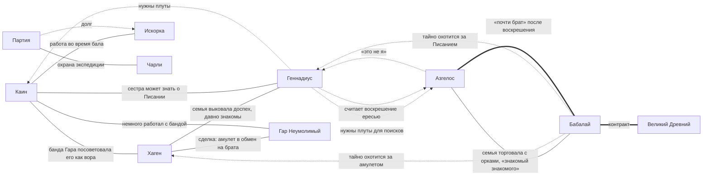

# Связи между персонажами

| Кто | С кем | Связь | Знает ли второй |
|---|---|---|---|
| Хаген | Геннадиус | доспех Геннадиуса выковала семья Хагена, давно знакомы | да |
| Хаген | Каин | банда Гара посоветовала Каина как опытного вора, чтобы выкрасть амулет | да |
| Каин | Геннадиус | сестра Каина может знать о Писании; Геннадиусу нужны плуты | да |
| Азгелос | Бабалай | семья Азгелоса торговала с орками в их походах; знакомые посоветовали держаться Бабалая | да |
| Бабалай | Хаген, Геннадиус | хочет забрать амулет и Писание для покровителя | **нет, тайна** |
| Все | Все | знакомы уже какое-то время и успели вместе что-то пережить | да |
| Каин | [Искорка](characters/npc/iskorka.md) и её босс | согласился поработать во время бала в обмен на помощь с его «проблемой» | Азгелос слышал разговор, остальные знают только, что какое-то задание есть |
| Партия | [Искорка](characters/npc/iskorka.md), [«Огненная дорога»](factions/fire-road.md) | за переполох в лагере за партией долг | да |
| Партия | [Чарли](characters/npc/charlie.md) | охраняют его экспедицию за серебряный в день | да |
| Азгелос | Геннадиус | хочет украсть принцессу, символ веры Геннадиуса; клянётся, что ночной переполох у замка устроил не он | Геннадиус сомневается |
| Азгелос | Геннадиус | после воскрешения на алтаре Геннадиус считает его ересью и подозревает | Азгелос знает о подозрении |
| Азгелос | Бабалай | Бабалай объявил его почти братом после воскрешения | да |
| Азгелос | Вайсши | укусила его, он умер и вернулся с тягой к ней | Вайсши вряд ли знает; партия знает |
| Каин | Вайсши | дважды попадал под её чары и отдал ей вещи | партия видела |
| Партия | [Чарли](characters/npc/charlie.md) | Чарли оплатил Азгелосу новую экипировку и вычел из зарплаты | да |
| Каин | партия | о сестре партии не рассказывал | нет |
| Азгелос | Вайсши | после укуса она говорит, что он «в её полной власти»; за службу обещает силу, за переход в религию империи — смерть | Азгелос знает; партия узнала от него |
| Азгелос | партия | без приглашения выдал тёмным эльфам планы Вайсши; Геннадиус требует молчать | Геннадиус в ужасе, остальные знают |
| Бабалай | Геннадиус | попросил благословения, Геннадиус отказал; Бабалай молился его богу и был связан | да |
| Партия | тёмные эльфы | переговоры у кромки леса; аудиенция у королевы назначена | да |

Общий принцип мастера: уход из партии после выполнения своей цели должен быть трудным выбором, а не само собой разумеющимся.
